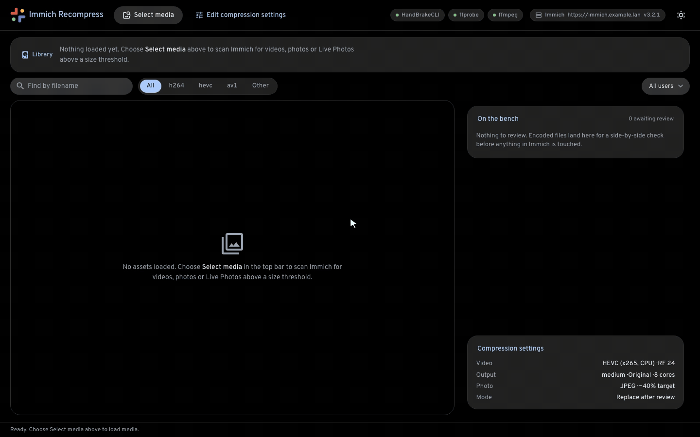

# Immich Recompress

Find the large videos and photos in your [Immich](https://immich.app/) library,
**recompress** them and replace the originals after you have reviewed the result.

<p align="center">
  
</p>

## Features

- Browse videos, photos or Live Photos, filtered by size, capture date, album,
  people and location.
- Re-encode videos with HandBrake (x264 / x265 / AV1, optional resolution cap),
  on the GPU when available. See [Hardware acceleration](#hardware-acceleration).
- Recompress JPEGs to a target size, or convert them to lossless JPEG XL
  (`djxl photo.jxl restored.jpg` restores the original JPEG).
- Strip the hidden motion video from Live Photos.
- **Review** every result (size, savings, preview) before it replaces the original.
- Queue with live progress and persistent job history.

Replacing uploads the compressed file as a new asset, copies the original's
metadata, tags, albums, capture date and location, and moves the original to
the Immich trash. A local backup is kept until the replacement succeeds.

## Requirements

- An Immich **3.x.x** server and an **admin** API key. Several keys
  (comma-separated) let you browse several users' libraries.
- [`HandBrakeCLI`](https://handbrake.fr/), [`ffmpeg` / `ffprobe`](https://ffmpeg.org/)
  and, for JPEG XL, [`cjxl` / `djxl`](https://github.com/libjxl/libjxl) on `PATH`.
  The Docker image includes all of them.
- Docker, or for local dev: Python 3.9+ and Node 22.23.4 + [pnpm](https://pnpm.io/)

## Quick start

> ### Early development
>
> This may still contain bugs, so use it with caution: **I don't guarantee
> against data loss.** Also read [SECURITY.md](SECURITY.md) before exposing it.

### Docker

#### Using the published image (recommended)

Put this `docker-compose.yml` next to a `.env` that sets `IMMICH_URL` and
`IMMICH_API_KEY` (see [`.env.example`](.env.example)):

```yaml
services:
  immich-recompress:
    image: ghcr.io/lukasganster/immich-recompress:latest
    container_name: immich-recompress
    restart: unless-stopped
    env_file:
      - .env # set IMMICH_URL and IMMICH_API_KEY here
    environment:
      IMMICH_DB: /data/immich_recompress.db
    ports:
      # Bound to 127.0.0.1: this app has NO authentication and can replace/trash
      # Immich media: do not expose it without an authenticating reverse proxy.
      # See SECURITY.md.
      - "127.0.0.1:${PORT:-5050}:${PORT:-5050}"
    volumes:
      - immich-recompress-data:/data # job-history SQLite DB
      - immich-recompress-backups:/tmp/immich_recompress_backup # pre-replace backups
      - immich-recompress-work:/tmp/immich_recompress_ui # download/encode scratch

volumes:
  immich-recompress-data:
  immich-recompress-backups:
  immich-recompress-work:
```

```bash
docker compose up -d
```

Then open <http://localhost:5050>. Pin a version such as `:1.3.1` instead of
`latest` for reproducible deploys.

#### Building from source

```bash
pnpm run env                    # creates .env; set IMMICH_URL and IMMICH_API_KEY in it
docker compose up -d --build
```

### Local

```bash
pnpm run setup                  # creates .venv with the Python deps
pnpm run env                    # creates .env; set IMMICH_URL and IMMICH_API_KEY in it
pnpm run install:frontend && pnpm run build:frontend
pnpm start                      # UI and API on http://127.0.0.1:5050
```

## Configuration

Set in `.env` (see [`.env.example`](.env.example)):

| Variable         | Required | Description                                          |
| ---------------- | -------- | ---------------------------------------------------- |
| `IMMICH_API_KEY` | yes      | Immich API key; comma-separate for multiple users    |
| `IMMICH_URL`     | yes      | Base URL of your Immich server                       |
| `PORT`           | no       | Listen port (default `5050`)                         |
| `HOST`           | no       | Dev-server bind address (default `127.0.0.1`)        |
| `IMMICH_DB`      | no       | SQLite job-history path (default `./immich_recompress.db`) |

## Hardware acceleration

The encoder list comes from your `HandBrakeCLI` build, so it only shows what
works. Hardware encoders are much faster; software encoders compress best and
let you limit the CPU cores.

| Platform | Hardware encoder | How to enable |
| -------- | ---------------- | ------------- |
| macOS | Apple VideoToolbox | Works out of the box. |
| Linux + Intel/AMD | QSV / VAAPI | Pass `/dev/dri` (below) + a HandBrake build with QSV/VAAPI. |
| Linux + NVIDIA | NVENC | [NVIDIA Container Toolkit](https://docs.nvidia.com/datacenter/cloud-native/container-toolkit/latest/install-guide.html) + GPU reservation (below) + a HandBrake build with NVENC. |

The stock Docker image ships a HandBrake build **without** GPU encoders. With a
build that has them, pass the GPU through:

```yaml
services:
  immich-recompress:
    devices:
      - /dev/dri:/dev/dri          # Intel/AMD (QSV / VAAPI)
    deploy:                         # NVIDIA NVENC (needs the Container Toolkit)
      resources:
        reservations:
          devices:
            - { driver: nvidia, count: all, capabilities: [gpu] }
```

## Contributing & license

Contributions welcome. See [CONTRIBUTING.md](CONTRIBUTING.md). Licensed under
the [MIT License](LICENSE).

[](https://buymeacoffee.com/lukasganster)
